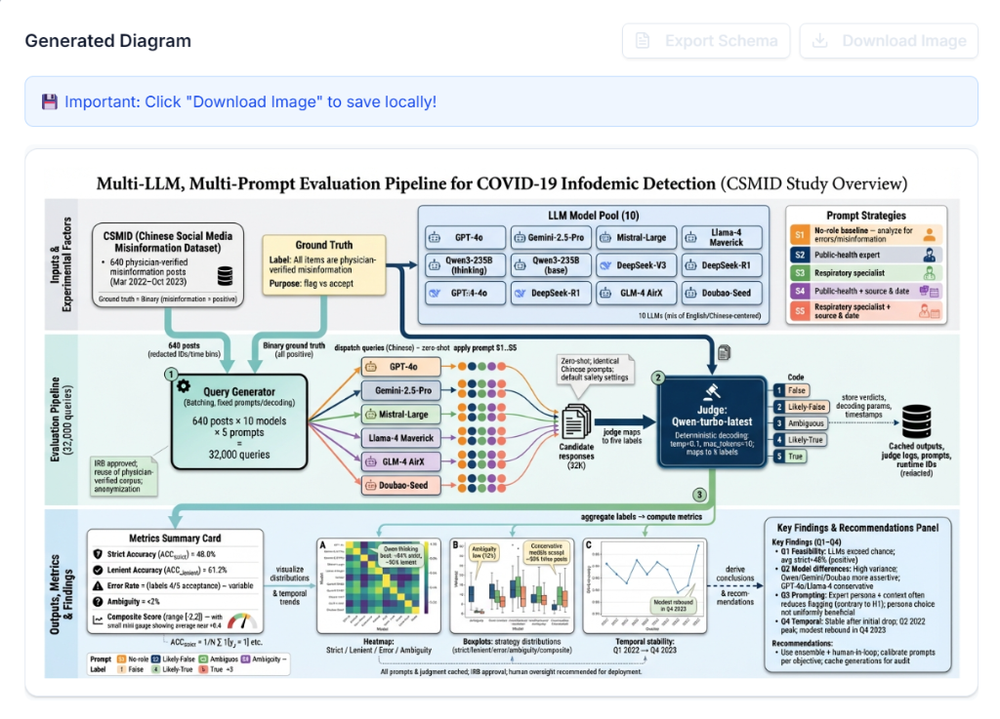

[](https://aia-academic-illustrator.vercel.app)

## Codex Skill 版本

本仓库新增 [`academic-illustrator`](skills/academic-illustrator/SKILL.md)，把原有的“论文 → 视觉蓝图 → 图片”工作流迁移到 Codex：

```text
论文 / PDF / 方法说明 → 当前 Codex 设计蓝图 → Codex 内置生图
                                              ↓ 按需
                              image-to-editable-ppt → 可编辑 PPTX
```

- **逻辑分析**由当前 Codex 完成，**图片生成/修改**使用内置 `image_gen.imagegen`；不需要原网页的模型 API Key 或前后端服务。
- 保留布局选择、分区、精确文字标签与连线等设计约束，新增实际出图检查和定向修正。
- 支持只生成蓝图、参考图引导、修改已有图，以及衔接已安装的 [`image-to-editable-ppt`](https://github.com/ningzimu/image-to-editable-ppt-skill)。PPT 拆解完整遵循该 Skill 的安装检查、OCR、页面分派、素材处理、后端回退、验证和组装流程，不另写简化版；不能用整页截图冒充可编辑对象。
- Skill 不提供网页调用内置模型的 HTTP 接口；下方原网页使用文档与 `frontend/`、`backend/` 代码仍保留，互不替换。

### 安装与调用

将 `skills/academic-illustrator` 整个目录复制到当前 Codex 的用户 Skill 目录（此环境为 `${CODEX_HOME:-$HOME/.codex}/skills/academic-illustrator`）。保留已有同名 Skill，比较后再更新，不直接覆盖。

```text
用 $academic-illustrator 把这篇论文的方法部分画成中文学术架构图。
用 $academic-illustrator 先生成视觉蓝图，等我确认再出图。
用 $academic-illustrator 生成技术路线图，并继续拆成可编辑 PPTX。
```

交付图片、`schema.md`、`render-prompt.txt`、`qa.md`；需要 PPT 时追加经过验证的 `.pptx`。学术主图的生成与修正固定使用 Codex 内置工具，不自动退回外部图像 API；进入 PPT 拆解后，图像后端与回退完全按 `image-to-editable-ppt` 原规则处理。

Skill 使用标准 `SKILL.md` 与可选资源目录结构，参见 [OpenAI Skill 文档](https://developers.openai.com/plugins/build/skills)。

---

<div align="center">

[English](#english) | 简体中文

[](https://nextjs.org/)
[](https://react.dev/)
[](https://typescriptlang.org/)
[](./LICENSE)

**✨ AI 驱动的学术图表自动生成工具**

支持 GPT + Gemini / DeepSeek 等多种模型

[在线体验](https://aia-academic-illustrator.vercel.app) / [ESA 加速版](https://aia.6b4dd083.er.aliyun-esa.net) / [本地部署](#-本地开发) / [视频教程](https://www.bilibili.com/video/BV1bMm3BYEKD/) / [问题反馈](https://github.com/qwwzdyj/AIA-Academic-Illustrator-/issues)

[](https://vercel.com/new/clone?repository-url=https://github.com/qwwzdyj/AIA-Academic-Illustrator-)

---

**🚀 本项目由阿里云 ESA 提供加速、计算和保护**

[](https://aia.6b4dd083.er.aliyun-esa.net)

#阿里云ESAPages #阿里云云工开物

</div>

---

## ✨ 效果展示



## ✨ 功能特点

- 📄 **智能分析** - 支持文本输入和 PDF/图片上传
- 🔄 **浏览器端 PDF 转换** - PDF 自动转换为图片（使用 pdf.js）
- 🎯 **Schema 生成** - AI 自动生成结构化视觉蓝图
- 🖼️ **图像渲染** - 使用 AI 模型生成高质量学术图表
- 📎 **参考图片** - 可上传参考图片指导生成风格
- 🌍 **双语支持** - 中文/英文界面
- 💾 **本地存储** - 历史记录保存在浏览器（最多 2 张图片）
- 🔑 **BYOK 模式** - 自带 API Key，数据安全

## 🤖 推荐模型配置

| 模型类型 | 用途 | 推荐模型 |
|----------|------|----------|
| **逻辑模型** | 分析论文生成 Schema | `gpt-5.1` / `deepseek-chat` / `gemini-3` |
| **视觉模型** | 生成学术图表 | `gemini-3-pro-image-preview` |

> 💡 提示：两个模型都可以通过 OpenAI 格式的 API 代理调用

## 📚 教程与资源

- **视频教程**: [Bilibili - Deepseek + Gemini 科研绘图工作流](https://www.bilibili.com/video/BV1bMm3BYEKD/?share_source=copy_web&vd_source=bea77ed0ad9ac826c1d942b45b9962c8) / [YouTube - English Tutorial](https://youtu.be/4bSQZxp0Qyk?si=eW8Si1fSPMzCHbSd)
- **研发作者**: 感谢该教程作者提供的灵感与工作流验证

## 🤝 致谢

特别感谢原创作者及社区的支持：

- **原创作者**: [@BAIKEMARK](https://github.com/BAIKEMARK)
- **原创文章**: [微信文章 / 博客](https://blog.051088.xyz/posts/25120721/)
- **社区支持**: Datawhale

## 🛠️ 技术栈


## 🚀 本地开发

```bash
# 克隆项目
git clone https://github.com/qwwzdyj/AIA-Academic-Illustrator-.git
cd AIA-Academic-Illustrator-/frontend

# 安装依赖
npm install

# 启动开发服务器
npm run dev
```

访问 http://localhost:3000

## 📖 使用流程

1. **Step 1 - 架构师**: 输入论文摘要或上传 PDF → 生成视觉蓝图
2. **Step 2 - 审阅**: 编辑优化 Schema，添加参考图片
3. **Step 3 - 渲染器**: 生成学术图表 → 下载保存

## 🌐 自行部署

> 注意：部署时需要设置 Root Directory 为 `frontend`

[](https://vercel.com/new/clone?repository-url=https://github.com/qwwzdyj/AIA-Academic-Illustrator-)

## 📄 许可证

[MIT License](./LICENSE)

---

<a name="english"></a>

<div align="center">

[](https://aia-academic-illustrator.vercel.app)

[简体中文](#) | English

[](https://nextjs.org/)
[](https://react.dev/)
[](https://typescriptlang.org/)
[](./LICENSE)

**✨ AI-Powered Academic Diagram Generation Tool**

Supports GPT-5.1 / DeepSeek / Gemini and more

[Live Demo](https://aia-academic-illustrator.vercel.app) / [Local Deploy](#-local-development) / [Issues](https://github.com/qwwzdyj/AIA-Academic-Illustrator-/issues)

[](https://vercel.com/new/clone?repository-url=https://github.com/qwwzdyj/AIA-Academic-Illustrator-)

</div>

---

## ✨ Demo


## ✨ Features

- 📄 **Smart Analysis** - Text input + PDF/image upload
- 🔄 **Browser-side PDF Conversion** - PDF to images using pdf.js
- 🎯 **Schema Generation** - AI generates structured Visual Schema
- 🖼️ **Image Rendering** - High-quality academic diagrams
- 📎 **Reference Images** - Style guidance support
- 🌍 **Bilingual** - Chinese/English UI
- 💾 **Local Storage** - History saved in browser (max 2 images)
- 🔑 **BYOK Mode** - Bring Your Own Key, data security

## 🤖 Recommended Models

| Model Type | Purpose | Recommended |
|------------|---------|-------------|
| **Logic Model** | Analyze paper, generate Schema | `gpt-5.1` / `deepseek-chat` / `gemini-3` |
| **Vision Model** | Generate academic diagrams | `gemini-3-pro-image-preview` |

## 🚀 Local Development

```bash
git clone https://github.com/qwwzdyj/AIA-Academic-Illustrator-.git
cd AIA-Academic-Illustrator-/frontend
npm install
npm run dev
```

Visit http://localhost:3000

## 🌐 Deploy Your Own

> Note: Set Root Directory to `frontend` when deploying

[](https://vercel.com/new/clone?repository-url=https://github.com/qwwzdyj/AIA-Academic-Illustrator-)

## 📚 Tutorial & Resources

- **Video Tutorial**: [Bilibili - Deepseek + Gemini Scientific Figure Workflow](https://www.bilibili.com/video/BV1bMm3BYEKD/?share_source=copy_web&vd_source=bea77ed0ad9ac826c1d942b45b9962c8) / [YouTube - English Tutorial](https://youtu.be/4bSQZxp0Qyk?si=eW8Si1fSPMzCHbSd)

## 🤝 Acknowledgements

Special thanks to the original author and community:

- **Original Author**: [@BAIKEMARK](https://github.com/BAIKEMARK)
- **Original Article**: [WeChat Article / Blog](https://blog.051088.xyz/posts/25120721/)
- **Community Support**: Datawhale

## 📄 License

[MIT License](./LICENSE)
